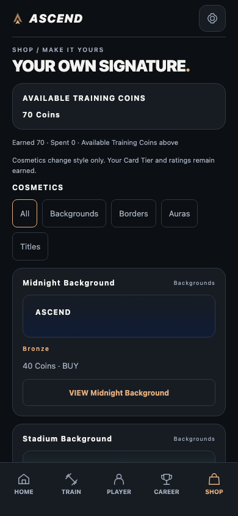
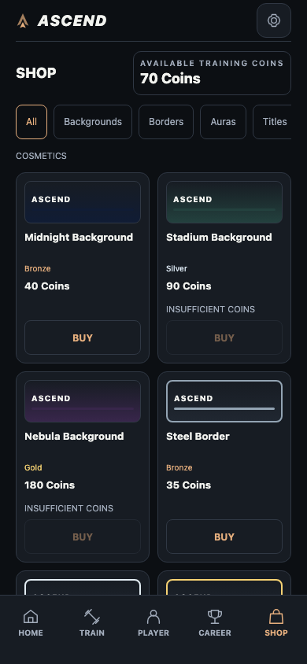
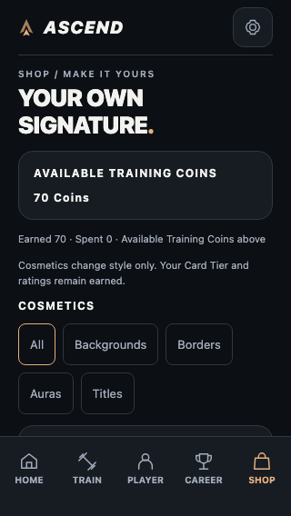
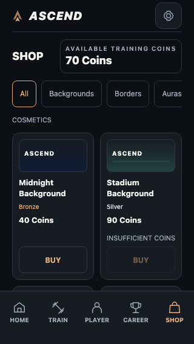
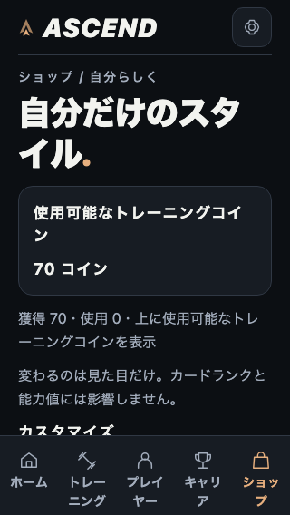
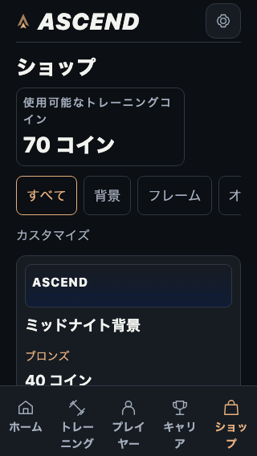

# Phase 5A.2 — SHOP UX Redesign

Date: 2026-10-27. Status: implementation/automated verification complete; native retest pending.

## Scope and original problems

Presentation-only redesign from baseline `f317712` (Phase 5A.1). The checkout uses
Expo 58.0.19 / React Native 0.88 / React 19.3. Read AGENTS.md and its SDK 57 reference,
then checked the applicable SDK 58 documentation. No package/configuration upgrade.

The old Screen put a large heading, full wallet panel, earned/spent explanation,
wrapped category controls and ten full-width Panels inside one ScrollView.
Each product repeated category/status information; BUY required VIEW then BUY then
CONFIRM. Owned equipment required VIEW then EQUIP. Details immediately rendered the
full PlayerCard even when a swatch was sufficient. Phase 5A.1's fixed action footer
worked and is retained.

## Design and implementation

- Compact SHOP/available-balance header; tap wallet for earned/spent details.
- Horizontal, selected category controls. Wallet and categories stay above the list.
- FlatList with stable catalog IDs, initial/batch limit 6 and bounded window 5.
  Two columns on ordinary 320/390px phones; one below 310px or fontScale >= 1.35.
  Measured title growth also enables the fallback for enlarged Web text.
- Lightweight local gradient swatches, names, textual rarity, price or OWNED/EQUIPPED,
  contextual accessible BUY/EQUIP/UNEQUIP controls. No PlayerCards in grid tiles.
- Grid BUY opens confirmation directly: exact identity, price, remaining balance,
  CANCEL and CONFIRM. Successful direct purchase returns to the same category/grid.
- Owned equipment changes directly without spending. Details remain available by
  tapping name/preview; the actual PlayerCard preview is optional and temporary.
- Details and confirmation share the existing safe-area Sheet and fixed action
  footer. No stacked modal, sound, animation dependency or remote asset is added.
- Category state remains mounted; pixel offset is retained across details/actions.
  Column changes remount FlatList safely with offset restoration. A deliberate
  category change starts its filtered list at the top.

## Wallet and persistence safety

All mutations still use existing ShopProvider actions and ShopRepository validation,
serialization, deterministic purchase identity and durable readback. No UI credit,
optimistic ownership, price override or alternate wallet formula exists. CoinBalance
gets an optional compact rendering using the same authoritative Shop snapshot.
Default HOME rendering is unchanged. Loading/error/owner/insufficient states explain
why buying is unavailable; insufficient Coins never disable owned equipment.

Catalog, prices, equipment semantics, PlayerCard adapter, Shop/Rewards schemas and
repositories, Match, Growth, OVR, PR, Career, Season and presentation consumption
are unchanged. Browsing/filtering/preview never invokes a mutation. Preview uses
actual Player ratings/overall and temporary equipment props, never fake Player data.

## Files

- `src/components/shop/storefront.tsx`: compact header/grid and interaction state.
- `src/components/shop/product-tile.tsx`: memoized tile and local swatch.
- `src/components/shop/layout.ts`: pure responsive column choice.
- `src/components/rewards/rewards.tsx`: optional compact CoinBalance rendering.
- `src/localization/locales/en.ts`, `ja.ts`: contextual actions/preview/feedback keys.
- `tests/shop-ux.test.cjs`, `shop-ux-fixture.cjs`, `browser-shop-ux.cjs`,
  `browser-shop-ux-compare.cjs`: responsive tests, isolated fixture, touch/comparison QA.
- `tests/browser-shop-purchase-fix.cjs`: explicitly requests optional full preview;
  original footer, safe-area, touch, storage and persistence assertions retained.
- `tests/browser-growth-debug.cjs`: dismisses only the identified pre-existing SVG
  warning through LogBox's close button; unexpected errors/storage assertions stay active.
- README and this report, with comparison screenshots under `docs/images/phase5a2/`.

## Browser-only before/after comparison

Same isolated initialized Player, four valid reward receipts (70 confirmed Coins),
unowned catalog, UTC, touch emulation and Reduce Motion. Baseline is an unmodified
archive of `f317712`; candidate uses the new UI. Measurements use geometry before
any automated scrolling, exclude covered/hidden tabs, and actually scroll to the last
product. Enlarged text scales both font size and line height, not native Dynamic Type.

| Locale / viewport / scale | Fully visible products before → after | Scroll to last product before → after | Reduction |
| --- | --- | --- | --- |
| EN 390×844 / 1× | 1 → 4 | 2,256 → 734 CSS px | 67% |
| EN 320×568 / 1× | 0 → 2 | 2,562 → 1,010 CSS px | 61% |
| JA 320×568 / 1.5× | 0 → 0 | 3,155 → 2,595 CSS px | 18% |

The enlarged Japanese case goes from no product to one partially visible product.
It intentionally uses one readable column; its BUY requires list scrolling. Normal
320/390px BUY is visible immediately. No critical control is clipped: list content
scrolls above the tabs, and modal actions have an independent fixed footer.

Purchase from browsing: VIEW → BUY → CONFIRM (**3 taps**) becomes BUY → CONFIRM
(**2 taps**). Equipping an already-owned item: VIEW → EQUIP (**2 taps**) becomes
EQUIP (**1 tap**). The comparison executes these flows, not only counts labels.
Wallet and category controls remain visible at the end of the new list in all three
cases; both scrolled out of view before. Expanded breakdown is deliberately optional.

### Screenshots (same fixture)

EN 390px before / after:

EN 320px before / after:

JA 320px / 1.5× text before / after:

## Verification

- Final `npm test`: **507 passed, 0 failed** (503 existing + four responsive tests).
- Final `npm run typecheck` and `npm run lint`: passed, exit 0.
- Final `env -u NO_COLOR CI=1 EXPO_OFFLINE=1 npx expo export --platform all
  --max-workers 1 --output-dir /tmp/ascend-shop-ux-final-export`: passed, exit 0;
  iOS/Android bundles and 13 static Web routes. Export is not native execution.
- `browser-shop-ux`: passed on final export at 320/390px, with coordinate touches,
  direct purchase/cancel/remaining 30, selected category retention, equip/unequip,
  PLAYER appearance, independent optional preview/footer, detail scroll retention,
  equipment-write failure/retry, 280px fallback and reload persistence. Unrelated
  storage remains byte-identical; no horizontal overflow or page exceptions.
- `browser-shop-ux-compare`: passed baseline and final candidate at all three
  table conditions, with zero browsing writes, actual purchase/equip, last-item
  reachability and no page exceptions. All six initial screenshots were visually
  inspected. [Raw measurements](images/phase5a2/metrics.json) are retained.
- Required existing production browsers passed: SHOP, SHOP Purchase Fix, Rewards,
  Match Rewards, Cards, Presentation, Overlays, Localization, Sessions.
- All **21 existing production browser suites** passed, exit 0: `browser-shop`,
  `browser-shop-purchase-fix` (EN, JA-large, unavailable, insufficient, uninitialized),
  `browser-rewards`, `browser-match-rewards`, `browser-cards`, `browser-presentation`,
  `browser-overlays`, `browser-localization`, `browser-sessions`,
  `browser-match-resolution`, `browser-match-history`, `browser-match-cinematic`
  (all 14 scenarios), `browser-match-integration`, `browser-career`, `browser-seasons`,
  `browser-growth`, `browser-records`, `browser-input`, `browser-audit`,
  `browser-coach`, `browser-localization-polish`.
- Existing development `browser-growth-debug` passed with the strict known-warning
  dismissal below, including zero writes and production entry absence. Thus all
  **22 existing browser suites** ran; none were skipped. Both new browser scripts
  passed as well. Final SHOP and purchase-fix reruns passed after the ARIA change.
- `git diff --check`: passed. Protected-source diff confirms `src/shop`,
  `src/storage`, `src/rewards`, `src/matches`, `src/growth`, `src/records`,
  `src/sessions`, `src/career`, `src/seasons`, `src/coach`, `src/cards`,
  `src/types`, `src/config` and Player Card source are unchanged. The separate
  CoinBalance presentation component is the UI-only change listed above. No app package/lock/config changes.

An initial new test found Web's selected/expanded state was not exposed by the
legacy accessibilityState prop alone; the new filters/wallet now also specify
explicit ARIA state. This changes no eligibility. A subsequent preview locator
matched the retained PLAYER tab and the new modal; the test now scopes to the
modal without removing its preview/footer assertions. The existing purchase-fix
test explicitly opts into the full card preview before testing independent scrolling.
No legacy integrity assertion was weakened.

The first development Debug attempt was blocked by SDK 58 LogBox's `error-toast`
over the tabs. Its test now dismisses the actual close button only when the latest
console error identifies the existing `accessible` non-boolean SVG warning; it does
not force clicks, hide overlays with CSS or suppress unexpected errors. The strict
rerun passed every zero-write/read-only assertion and production-entry absence.
Development Metro also printed lazy-bundle-loader console frames during reload;
passing Debug runs reported no page exceptions. This patch does not alter the
unrelated SVG renderer or upgrade dependencies to silence development diagnostics.
Final typecheck/lint/export reported no warnings.

Required regressions ran sequentially against the initial candidate export.
After the ARIA-state-only adjustment, all-platform export, full unit suite,
typecheck/lint, new touch/comparison tests and both SHOP legacy suites were rerun
against the final source/output. Gameplay/persistence sources remained unchanged.
Browser tooling (Playwright/Prettier) is external under `/tmp/ascend-shop-ux-qa`,
not an application dependency. Set `NODE_PATH` to its `node_modules`,
`PLAYWRIGHT_BROWSERS_PATH` to its `browsers`, and `ASCEND_QA_URL` to a served export.
The Debug suite additionally needs a Metro development URL and `ASCEND_QA_PROD_URL`.
For comparison, set `ASCEND_QA_COMPARE=before|after` and use corresponding exports;
root restart uses `/` because the simple Python test server lacks route fallback.

## Native limits and iPhone retest

No physical-device verification was performed for Phase 5A.2. Browser measurements,
font/line-height scaling, touch emulation and safe-area probes do not establish native
Dynamic Type, VoiceOver, hit testing or rendering performance. No multi-year catalog
performance benchmark is claimed. Memoized lightweight tiles and virtualization avoid
rendering a PlayerCard per product; Provider updates can still rerender visible tiles.

1. Preserve data. `cd my-app` → `npx expo start --go --lan` → compatible Expo Go.
2. Open SHOP. Confirm real available Coins, horizontal categories and first product
   row. Scroll to the end: wallet/categories remain accessible, tabs do not cover items.
3. With a genuine affordable unowned item, tap BUY: verify name/price/remaining.
   CANCEL must preserve balance/ownership. Confirm only a purchase you actually want.
4. Check OWNED, exact debit and HOME/SHOP agreement. EQUIP directly, check PLAYER,
   UNEQUIP and re-equip if desired: no additional spending or loss of ownership.
5. Open optional details/PlayerCard preview. BUY/EQUIP/UNEQUIP/CLOSE must stay reachable
   independently of preview scrolling. Category and scroll position should remain.
6. Navigate, Expo Reload and restart. Ownership/equipment/balance must persist.
7. EN/JA, large Dynamic Type, VoiceOver and Reduce Motion: verify readable wrapping,
   one-column fallback, selected category, contextual labels and 44pt actions with
   actual safe areas. Do not reset storage, alter Coins or fabricate workout evidence.

Stop after Phase 5A.2. Phase 5B, new cosmetics and AVS are not implemented.
