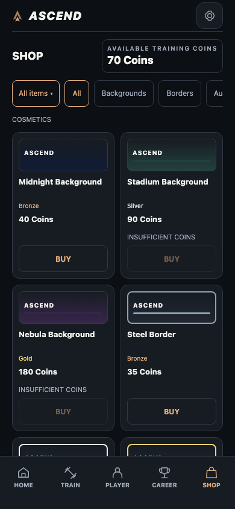
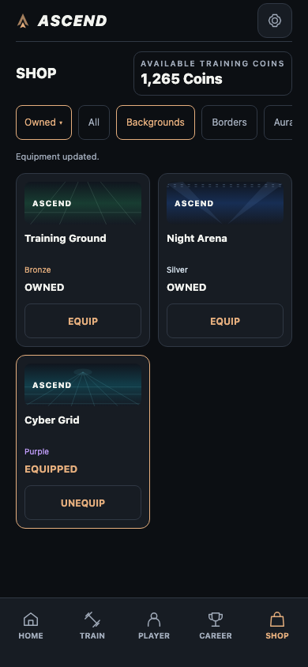
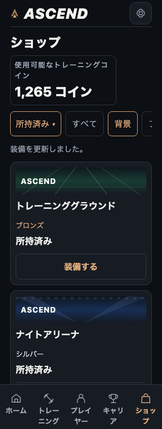
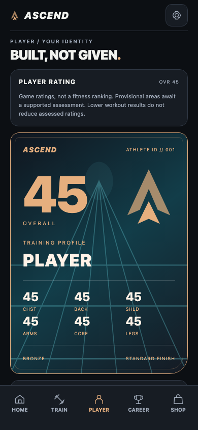
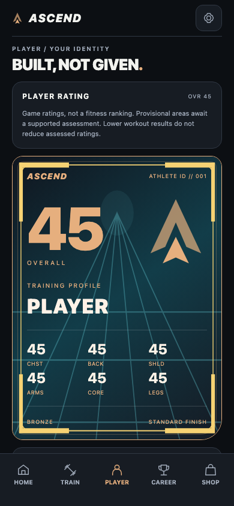
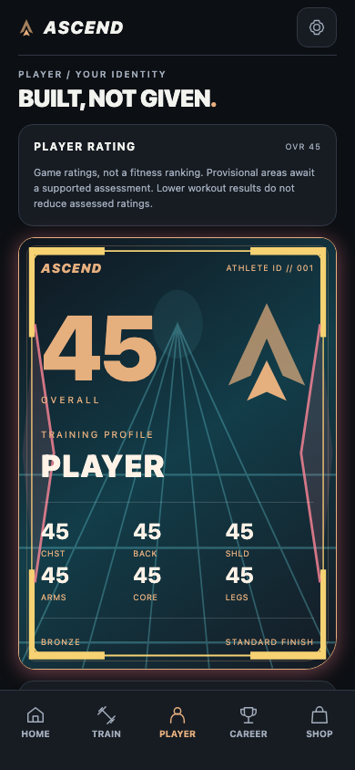
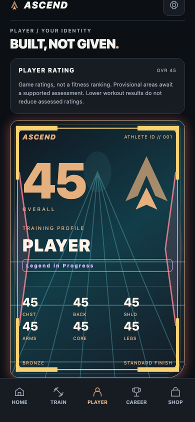

# Phase 5B — SHOP Expansion & Cosmetic Progression

Date: 2026-10-28. Implementation and automated verification complete; native retest pending.

## Pre-implementation audit

Baseline `3554113`, clean working tree. Expo ^58.0.19, React Native 0.88.0,
React 19.3.0. Read AGENTS.md's exact SDK 57 reference and the actual SDK 58 reference,
all three 5A verification reports, Shop catalog/domain/provider/repository, wallet,
PlayerCard, cosmetic adapter, responsive grid, localization and tests before coding.
No dependency upgrade is planned.

Existing immutable catalog, in saved deterministic order:

| ID | Slot | Price | Rarity |
| --- | --- | ---: | --- |
| bg-midnight | background | 40 | bronze |
| bg-stadium | background | 90 | silver |
| bg-nebula | background | 180 | gold |
| border-steel | border | 35 | bronze |
| border-chrome | border | 85 | silver |
| border-gold | border | 175 | gold |
| aura-blue | aura | 100 | silver |
| aura-purple | aura | 260 | purple |
| title-rookie | title | 30 | bronze |
| title-rising-star | title | 150 | gold |

All four slots resolve by stable ID through cosmeticAppearance. Existing background
is a tier-based gradient, border an inset colored frame, aura a shadow/left stripe,
and title localized text. New static treatment metadata can extend these visuals
without changing Equipment, purchases, catalogVersion or any persistence schema.
Legacy rendering branches will remain unchanged. No new tier/unlock restriction.

## Curated additions and pricing plan

| ID | EN / JA | Slot | Price | Rarity | Shared visual treatment |
| --- | --- | --- | ---: | --- | --- |
| bg-training-ground | Training Ground / トレーニンググラウンド | background | 40 | bronze | Green field lanes |
| bg-night-arena | Night Arena / ナイトアリーナ | background | 110 | silver | Blue stadium beams |
| bg-cyber-grid | Cyber Grid / サイバーグリッド | background | 200 | purple | Cyan perspective grid |
| border-carbon | Carbon Frame / カーボンフレーム | border | 50 | bronze | Graphite segmented frame |
| border-platinum | Platinum Frame / プラチナフレーム | border | 120 | silver | Cool double frame |
| border-champion | Champion Frame / チャンピオンフレーム | border | 220 | gold | Gold corner brackets |
| aura-electric | Electric Pulse / エレクトリックパルス | aura | 130 | silver | Static cyan edge bolts |
| aura-crimson | Crimson Energy / クリムゾンエナジー | aura | 190 | gold | Red edge diamonds |
| title-challenger | Challenger / チャレンジャー | title | 45 | bronze | Cyan underline badge |
| title-legend | Legend in Progress / レジェンドへの道 | title | 210 | purple | Violet framed badge |

Rewards remain Daily 10, third distinct Monday–Sunday training day Weekly 30,
and completed Match WIN/DRAW/LOSS 25/15/10. Three training days normally earn 60
per week before any Match reward. Starter additions cost 40–50, mid-range 110–130,
premium 190–220 (about 3.2–3.7 such training weeks before Match Coins). No daily
streak, extra-workout incentive, scarcity, randomness, OVR gate or reward change.
The old 260 premium ceiling remains untouched. Prices are immutable v1 evidence.
All descriptions will state static presentation rather than advertise animation.

## Implementation and compatibility

The catalog now contains 20 entries. Original objects remain the exact first ten
(including colors and absence of treatment metadata); additions append in the order
above. A checked-in baseline fixture locks all original fields. Static optional
`treatment` metadata belongs only to the catalog, never Shop records. `cosmeticAppearance`
continues resolving the same four Equipment slots. No new ownership source or schema.

`CosmeticArt` draws the same original local SVG paths in tile/detail swatches and
PlayerCard. Backgrounds share neutral gradient tokens; titles share badge styles.
Legacy swatch/card branches are preserved. Earned tier accents, OVR and statistics
remain visible; the screenshots deliberately show premium equipment on OVR 45 Bronze.
All effects are static, with no flashing, motion dependency, remote asset or sound.
Card Evolution and other shared PlayerCard users inherit the same adapter/renderer.

The ownership menu lives alongside the horizontally scrolling categories in the
same row, rather than adding a second bar. All items is default. Owned/Unowned join
only the validated Shop snapshot, combine with category, and have a localized empty
state. When ownership is unavailable they do not invent unowned status. Explicit
filter changes reset that filtered list; details/actions retain category and reasonable
offset. Purchase while Unowned is active removes the item without selecting All.
Owned equipment state updates immediately after durable confirmation.

The existing Provider/Repository/domain are byte-identical to baseline. BUY still
rechecks durable Player ownership, funding and available Coins in the shared adapter
queue; one record is debit plus permanent entitlement, with deterministic ID and
readback before publication. Equip never spends; slot replacement preserves other
slots. Preview/browsing/filtering write nothing. Failed storage is not reset/repaired.
Rewards v1/v2, wallet formula, price evidence and Shop v1/catalogVersion 1 are unchanged.
Existing purchases/gear load without migration. Binaries predating these new IDs
cannot interpret new-item purchases; downgrade after such a purchase is unsupported.

### Files

- `src/shop/catalog.ts`: ten immutable additions and optional static treatment type.
- `src/shop/discovery.ts`: pure ownership/category selector.
- `src/shop/visuals.ts`, `components/shop/cosmetic-art.tsx`: shared visual definitions.
- `components/shop/product-tile.tsx`, `storefront.tsx`: previews and compact filter menu.
- `components/player/player-card.tsx`: new-treatment branches, legacy paths retained.
- `localization/locales/en.ts`, `ja.ts`: typed item descriptions and filter labels.
- `tests/shop-expansion.test.cjs`, `tests/fixtures/shop-v1-catalog.json` and expanded
  `shop.test.cjs`: compatibility, new purchases, equipment and pure selectors.
- `tests/browser-shop-expansion.cjs`: every new product through real SHOP and PLAYER.
- `tests/browser-shop-ux-compare.cjs`: uses actual final catalog item and configurable
  screenshot output directory, retaining scrolling/action/no-write assertions.
- README, this report and isolated screenshots under `docs/images/phase5b/`.

## Screenshots and compact layout

Same initialized Player / 70 Coins / EN / 390×844 / normal text before and after:

The first viewport still fully displays four items at 390px and two at 320×568.
Wallet/categories remain visible; BUY requires two taps and EQUIP one. Catalog size
has doubled, so scrolling All to the final item increases (390px 734 → 2,003 CSS px;
320px 1,010 → 2,279; JA 1.5× text 2,595 → 5,354). Ownership/category filters avoid
requiring that full-catalog traversal. This is browser-only measurement; it is not
an iPhone performance claim. [Expanded measurements](images/phase5b/expanded-metrics.json).

Real equipped PlayerCard with cumulative new layers (synthetic QA data only):

## Verification

- `npm test`: **532 passed, 0 failed** (507 baseline + ten additional existing
  purchase-loop cases + 15 focused expansion tests).
- `npm run typecheck`, `npm run lint`: passed.
- `env -u NO_COLOR CI=1 EXPO_OFFLINE=1 npx expo export --platform all --max-workers 1
  --output-dir /tmp/ascend-phase5b-export`: passed; iOS/Android and 13 static Web routes.
- New browser suite passed EN 390px and JA 320px: all ten new products preview and
  equip with unchanged OVR/tier/source bytes, combined/empty filters, cancel with
  zero writes, Unowned purchase removal, exact 1,315 total spending, 1,265 remaining
  from 2,580 valid isolated earned Coins, no-charge equip/unequip, reload and balance
  agreement. EN/JA 1.5× font and line-height approximation switches to one column.
- Existing SHOP rerun, Purchase Fix (all five cases), SHOP UX and UX comparison passed.
  All **23 existing production browser scripts** passed: `shop`, `shop-purchase-fix`
  (all five cases), `shop-ux`, `shop-ux-compare` (candidate mode, all three viewports),
  `rewards`, `match-rewards`, `cards`, `presentation`, `overlays`, `localization`,
  `sessions`, `match-resolution`, `match-history`, `match-cinematic` (all 14 cases),
  `match-integration`, `career`, `seasons`, `growth`, `records`, `input`, `audit`,
  `coach`, `localization-polish` (all have the `browser-` prefix).
  The original SHOP attempt failed during root navigation; its separate complete
  rerun exited 0. All other sequential production suites exited 0 initially.
  Together with the existing development Debug script and new expansion script,
  **25 browser scripts** were executed successfully; none were skipped.
- Development Growth Debug passed: opening/refreshing writes nothing, exact saved
  decimals, missing/corrupt/retry and production-entry absence remain unchanged.
- No page exceptions or horizontal overflow in successful new flows. Initial,
  Owned, enlarged Japanese and all four Player Card screenshots were inspected.

An initial dictionary insertion landed inside a type import; corrected before the
successful full rerun/export. The new virtualized-list test initially saw a cell
unmount mid-scroll; its bounded locator retries now wait for the actual visible cell.
An initial legacy SHOP restart encountered ERR_ABORTED; rerun passed without any
product/test change. The expanded-list comparison similarly waits for bounded virtualized remeasurement
instead of assuming eight scroll steps; it still strictly checks final-item bounds,
no-write browsing, actual confirmation/equip and page errors. Comparison images now
use a temporary directory by default or `ASCEND_QA_SCREENSHOT_DIR`; original Phase
5A.2 screenshot bytes remain intact. No existing assertion was weakened. The all-items equipment
fixture now earns enough valid Coins for 20 products and uses a corresponding later
fixture clock; the original full-catalog assertions remain.

`git diff --check` passed. Relative to baseline 3554113, protected Shop domain/
Provider/Repository, all storage modules, Rewards, Match, Growth/OVR/PR, Sessions,
Coach, Career/Seasons, card thresholds, schemas, package/lock and platform config
are unchanged. Only the listed catalog/rendering/filter/localization/test/docs change.
The intermediate Phase 5B checkpoint 437eb75 was preserved when continuing work.

Typecheck/lint/export reported no new warnings. Development Metro retains the known
`accessible={false}` SVG warning; the existing Debug test dismisses that identified
LogBox toast with its real close button. No page exceptions occurred in passed tests.
No unrelated renderer/dependency change was made to suppress the warning.

Playwright/Prettier are external tools under `/tmp/ascend-shop-ux-qa`, not app
dependencies. Set `NODE_PATH` to its node_modules, `PLAYWRIGHT_BROWSERS_PATH` to its
browsers, and `ASCEND_QA_URL` to the served export. Debug additionally needs a Metro
URL and `ASCEND_QA_PROD_URL`. Restarts use `/` because the simple test server lacks
extensionless route fallback. Every deliberate reward/ownership fixture is isolated;
real phone data was neither read nor edited.

## Native limits and retest

No physical iPhone/simulator/Hermes runtime, VoiceOver or Dynamic Type verification
is claimed. Static export is compilation. Browser screenshots/touches/font scaling
are not native evidence. Full cards remain optional; list swatches use a few static
SVG primitives. No large-catalog native memory/FPS benchmark or all tier/equipment
permutation test is claimed. Very large text intentionally uses a single column;
list scrolling can be necessary to reach the primary action. Modal actions stay fixed.
Existing shared-adapter single-process wallet guarantees remain; no cross-device lock.

1. Preserve real data; `cd my-app` → `npx expo start --go --lan` → compatible Expo Go.
2. Check HOME/SHOP balance and old owned/equipped items, OVR/tier, PRs, Club and Season.
3. SHOP: open ownership menu, try All/Owned/Unowned with each category. Check empty
   state, selected label, wallet visibility and ordinary scrolling.
4. Open new item details and optional real-card preview. Verify static patterns,
   frame/aura/title agree. CLOSE and purchase/equipment footer remain reachable.
5. Only buy an item you want using genuinely earned funds. CANCEL first: no change.
   Confirm an affordable item: exact debit once, OWNED, removed from Unowned.
6. EQUIP/UNEQUIP and switch within a slot. PLAYER reflects it; other slots, earned
   tier and Coins remain unchanged. HOME/SHOP agree. No OVR requirement applies.
7. Navigate, Expo Reload and restart: ownership/equipment/balance survive with no
   duplicate debit. Normal workouts/Match rewards still use the original rules.
8. EN/JA, large Dynamic Type, VoiceOver, Reduce Motion, safe areas and small-screen
   horizontal filters/list scrolling. Do not reset or inject real storage to test.

No new currency, XP, drops, timers, pay-to-win benefit, monetization, inventory model,
search, sorting or wishlists. Those ideas are deferred, not started. Stop after
Phase 5B. No Phase 5C or AVS implementation.
